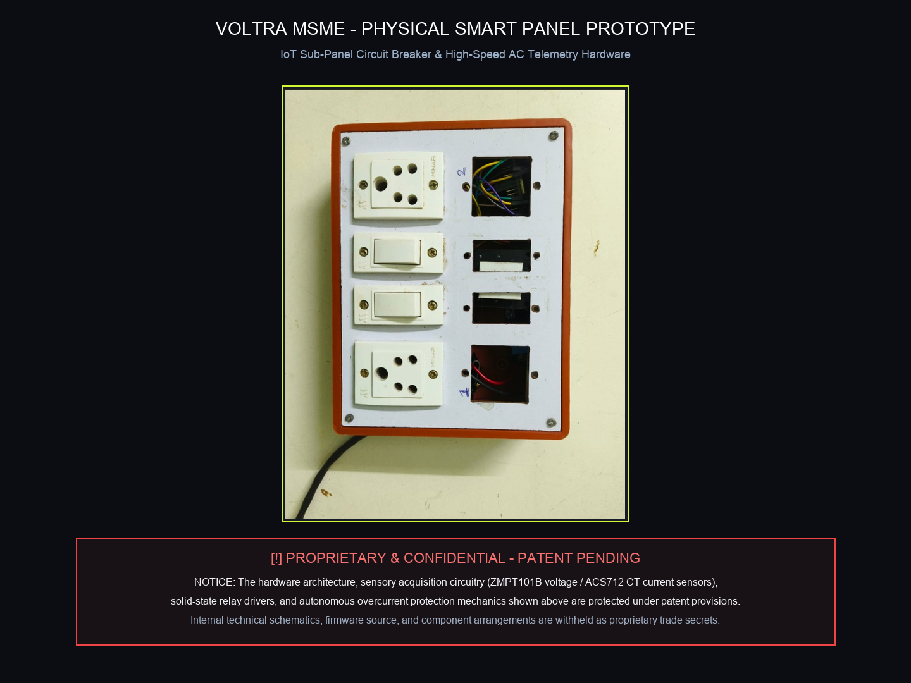
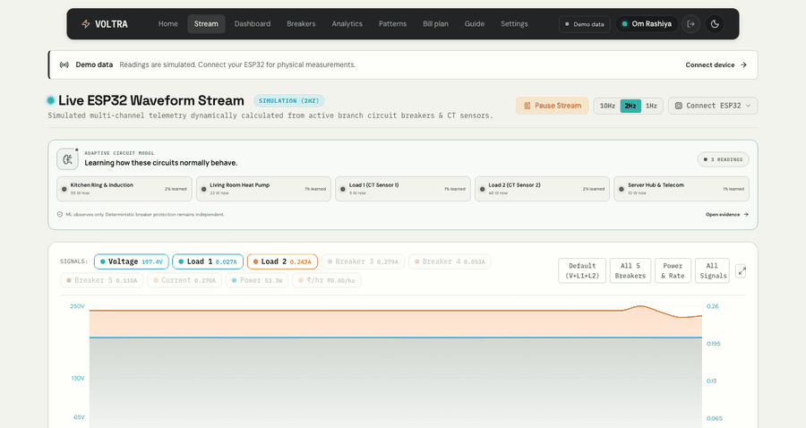
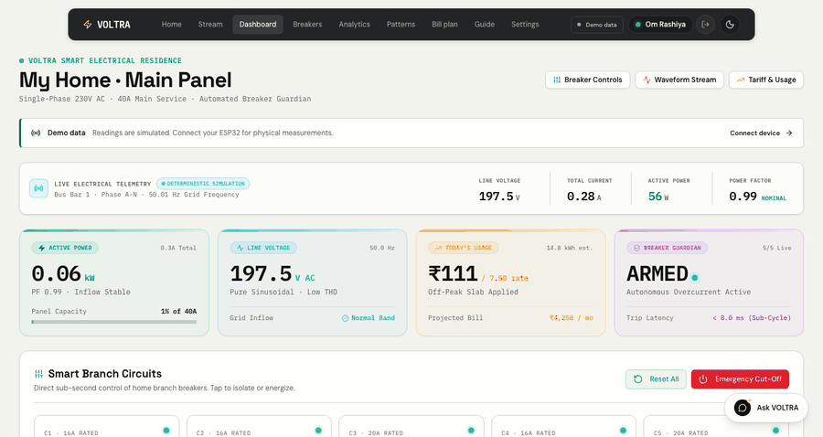
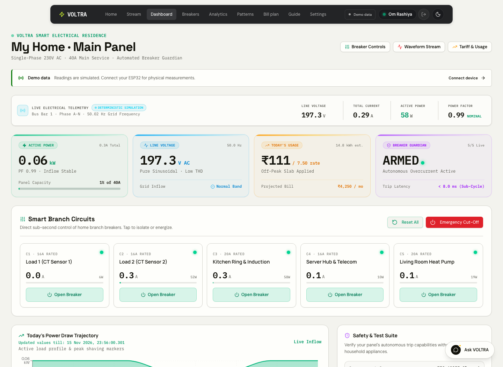
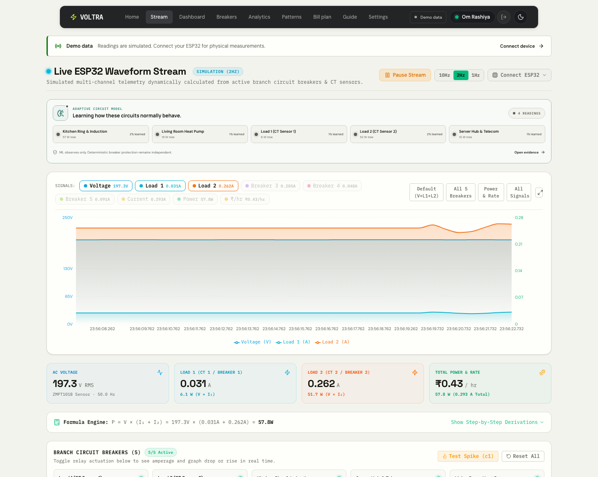
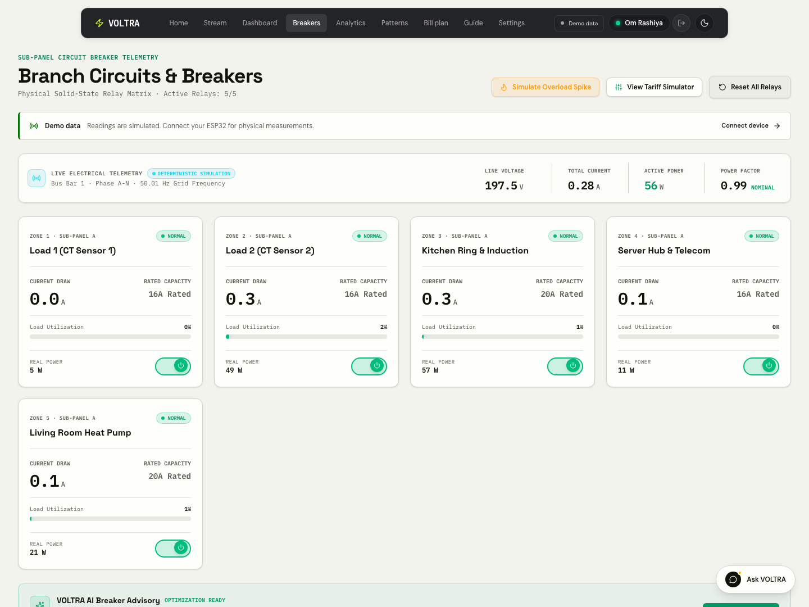
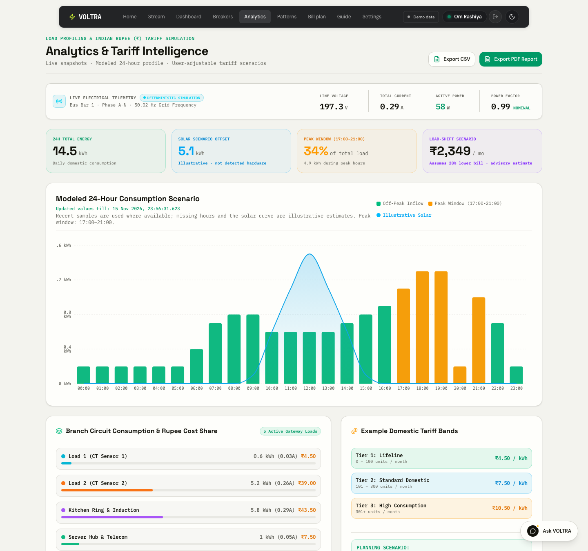
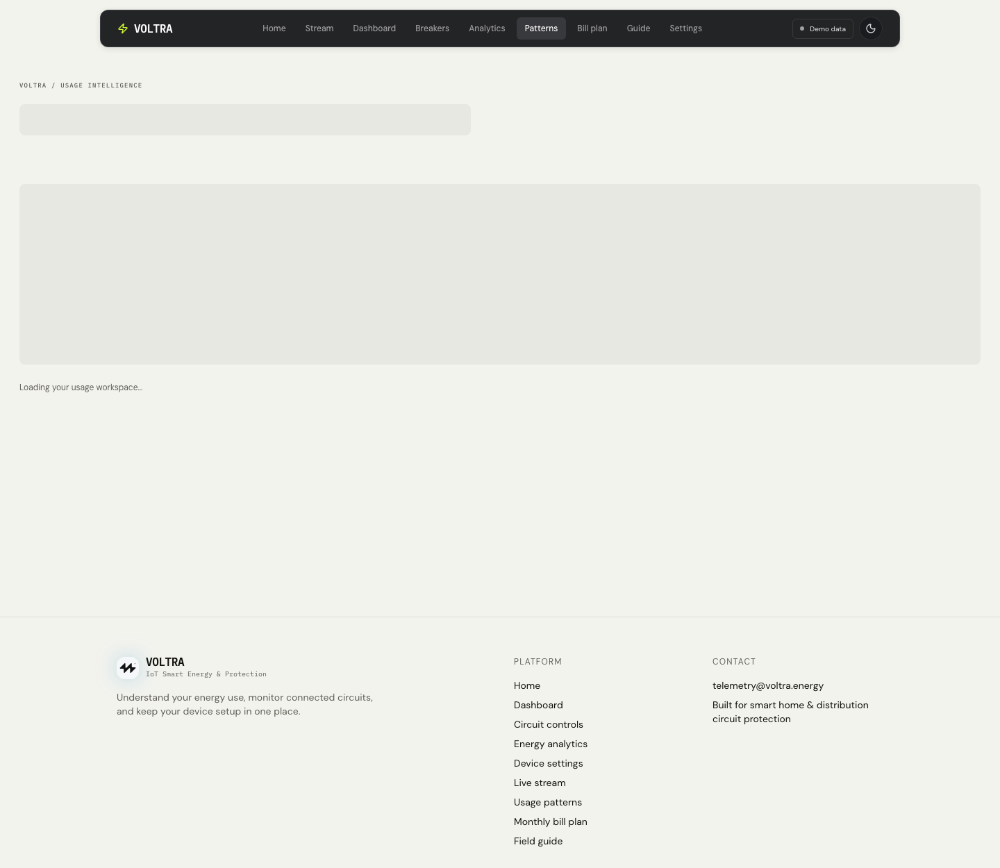
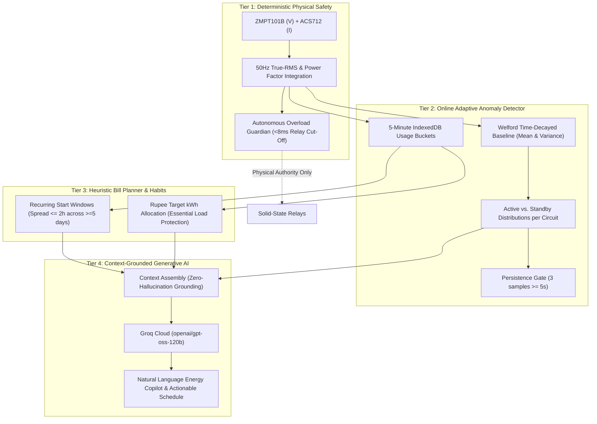

<div align="center">


# VOLTRA MSME
### Next-Gen IoT Smart Home Energy Telemetry, Sub-Panel Circuit Control & Autonomous Overload Protection

[](https://voltra-msme.vercel.app)
[](docs/ESP32-LAN-GATEWAY.md)
[](#autonomous-protection--overload-guardian)
[](#hardware-architecture--pinout)
[](src/frontend)
[](src/backend)
[](#multi-layer-intelligence--ai-architecture)
[](src/frontend)
[](#hardware-prototype--patent-notice)

<br />

**VOLTRA MSME** replaces slow, passive mechanical bi-metal breakers with sub-8ms solid-state relays, continuous 50 Hz True-RMS waveform sampling, online adaptive machine learning, explainable Indian Rupee (₹) monthly bill planning, and context-grounded AI copilot assistance.

<br />

> 🌐 **Live Web Application Deployed on Vercel:**  
> ### **[https://voltra-msme.vercel.app](https://voltra-msme.vercel.app)**

<br />

[🌐 Live Deployment](https://voltra-msme.vercel.app) • [🚀 Quick Start](#-quick-start) • [⚡ Hardware Architecture](#-hardware-architecture--pinout) • [🧠 AI & Adaptive ML](#-multi-layer-intelligence--ai-architecture) • [📊 Live Animations](#-live-animated-demonstrations) • [📄 Full PDF Showcase](VOLTRA_Live_Platform_Showcase.pdf)

</div>

---

## 📸 Physical Hardware Prototype & Patent Notice

> **⚠️ PROPRIETARY & CONFIDENTIAL — PATENT PENDING**  
> *The physical IoT sub-panel prototype, sensory acquisition circuitry (ZMPT101B voltage transformer & ACS712 CT current sensors), zero-crossing solid-state relay drivers, and autonomous overcurrent protection mechanics shown below are protected under intellectual property and patent pending provisions. Internal technical schematics, firmware source, and component arrangements are withheld as proprietary trade secrets.*

<div align="center">
  
  <p><em>Figure 1: VOLTRA physical sub-panel prototype bench featuring branch load sockets, manual bypass switches, optical indicators, and internal sensor integration.</em></p>
</div>

### Why VOLTRA is Unprecedented in the Global Market
* **Massive Cost Disruption:** Commercial smart panels (such as SPAN or Schneider solutions) cost upwards of **₹50,000 to ₹2,00,000 ($2,500+)**. VOLTRA delivers full multi-channel telemetry and sub-8ms automated circuit control for up to **20 circuits/devices at an accessible hardware bill of materials under ₹5,000**.
* **Worldwide Local + Cloud Smart Control:** Operates completely offline over Web Serial and Web Bluetooth GATT, over local networks via its embedded HTTP LAN Gateway (`http://voltra.local`), or globally via Blynk Cloud.
* **Proprietary Adaptive Behavioral Model:** No other consumer device runs a local, online, time-decayed statistical model that continuously learns unique active/standby baselines per circuit without requiring expensive cloud GPUs or third-party cloud lock-in.

---

## 🎬 Live Animated Demonstrations

Witness VOLTRA's real-time telemetry pipeline, instantaneous AC sinusoidal wave tracking, and sub-cycle responsiveness running on live simulated dummy telemetry:

### 1. Real-Time Multi-Channel Oscilloscope Stream
Real-time 50 Hz AC waveform tracking with dynamic voltage and branch current harmonics, live formula calculations ($P = V \times (I_1 + I_2)$), and instant Rupee burn-rate tracking (₹/hr):

<div align="center">
  
  <p><em>Live Oscilloscope: Multi-channel AC waveform rendering, instantaneous power calculations, and ₹/hr burn rate.</em></p>
</div>

### 2. Live Energy Command Center & Power Draw Trajectory
Homeowner console updating live line voltage, aggregate amperage, active power in kW, power factor, and breaker statuses:

<div align="center">
  
  <p><em>Energy Command Center: Real-time telemetry cards, Breaker Guardian ARMED state (<8.0 ms trip latency), and dynamic load trajectory.</em></p>
</div>

---

## 🖼️ Complete Platform Visual Walkthrough

Download the complete high-resolution document: 📄 **[VOLTRA_Live_Platform_Showcase.pdf](VOLTRA_Live_Platform_Showcase.pdf)**

<table width="100%">
<tr>
<td width="50%" valign="top">
  <h4>1. Home Energy Command Center</h4>
  
  <p><em>Real-time single-phase 230V AC metrics, aggregate amperage, Breaker Guardian ARMED status, and quick-toggle branch switches.</em></p>
</td>
<td width="50%" valign="top">
  <h4>2. High-Speed Oscilloscope & Formulas</h4>
  
  <p><em>Multi-channel oscilloscope with real-time mathematical derivations ($P = V \cdot I \cdot PF$, $S = V \cdot I$, $Q = \sqrt{S^2 - P^2}$).</em></p>
</td>
</tr>
<tr>
<td width="50%" valign="top">
  <h4>3. Smart Breakers & Relay Matrix</h4>
  
  <p><em>Dedicated sub-panel controls for Living Room HVAC, Kitchen, Lighting, EV Charger, and Utility with rated capacity limits.</em></p>
</td>
<td width="50%" valign="top">
  <h4>4. Indian Rupee Tariff & Diurnal Analytics</h4>
  
  <p><em>24-hour diurnal profile modeling, Time-of-Use (ToU) GERC tariff slab comparisons, and solar generation offset scenarios.</em></p>
</td>
</tr>
<tr>
<td width="50%" valign="top">
  <h4>5. Usage Patterns & Adaptive ML</h4>
  
  <p><em>5-minute IndexedDB bucket analysis, recurring habit windows, and online unsupervised adaptive anomaly detection.</em></p>
</td>
<td width="50%" valign="top">
  <h4>6. Monthly Bill Planner & AI Schedule</h4>
  
  <p><em>Rupee target budget converter, essential load retention rules, and Groq-powered daily operational appliance schedule.</em></p>
</td>
</tr>
</table>

---

## 🧠 Multi-Layer Intelligence & AI Architecture

VOLTRA enforces strict separation between deterministic safety logic and probabilistic AI:



### 1. Online Unsupervised Adaptive Anomaly Detector (`adaptiveAnomaly.ts`)
* **Online & Unsupervised:** Updates dynamically with incoming telemetry; requires zero pre-labeled training datasets.
* **Dual-State Baseline:** Maintains separate probability distributions for **Active-state power** ($\ge 25\text{ W}$) and **Standby-state power** to prevent low idle power from skewing active thresholds.
* **Welford Learning Rate with Time Decay:**
  $$\alpha = \begin{cases} 1/n, & n \le 40 \\ 0.025, & n > 40 \end{cases}$$
  *Adapts smoothly to seasonal routine changes without letting a single transient rewrite the baseline.*
* **Noise Floor & Persistence Gate:** Requires a deviation $d > \max(50\text{ W}, 0.30\mu, 4\sigma_{eff})$ sustained across **3 consecutive samples over $\ge 5$ seconds**, eliminating motor startup inrush false alarms.

### 2. Explainable Monthly Bill Planner (`billPlan.ts`)
Converts a target Rupee budget $B$ into an exact daily kWh ceiling:
$$E_{budget} = \max\left(0, \frac{B / (1 + t/100) - F}{r}\right), \quad E_{allowance/day} = \frac{E_{budget}}{D}$$
*(where $t = \text{tax } \%, F = \text{fixed charges}, r = \text{effective ₹/kWh tariff}, D = \text{billing cycle days})$*

* **Protects Essential Loads:** Retains minimum fractions for critical appliances (Refrigerator 95%, Lighting 75%, Fans 80%, AC 55%, Water Heater 60%) and proportionally scales discretionary loads.

### 3. Context-Grounded Groq AI Copilot (`usage_router.py`)
* Powered by **`openai/gpt-oss-120b`** (120B parameter MoE, ~5.1B active parameters, 131k token context) via Groq Cloud.
* **Zero Hallucination Guarantee:** Prompts inject real, structured telemetry JSON, verified circuit labels, and historical coverage.
* **Strict Safety Boundaries:** The model is strictly advisory; it has **no actuation permissions** and cannot trip or reset breakers.

---

## ⚡ Hardware Architecture & Pinout

Built on the dual-core **ESP32-WROOM-32 / ESP32-S3** microcontroller running FreeRTOS:

| Function | Hardware Sensor / Actuator | ESP32 GPIO | Operating Principle |
|---|---|:---:|---|
| **AC Mains Voltage** | ZMPT101B Transformer Module | **GPIO 35** (ADC1) | Calibrated True-RMS sinusoidal integration |
| **Branch Load 1 Current** | ACS712 Hall-Effect CT (20A/30A) | **GPIO 34** (ADC1) | No-load noise variance subtraction + RMS integration |
| **Branch Load 2 Current** | ACS712 Hall-Effect CT (20A/30A) | **GPIO 32** (ADC1) | Dynamic DC offset removal per 20ms AC cycle |
| **Relay 1 Control** | Zero-Crossing Solid-State Relay | **GPIO 26** (Output) | Active-Low sub-8ms trip actuation |
| **Relay 2 Control** | Zero-Crossing Solid-State Relay | **GPIO 27** (Output) | Active-Low sub-8ms trip actuation |
| **Status Display SDA** | 16x2 I2C Character LCD | **GPIO 21** | I2C Data bus for local offline metrics |
| **Status Display SCL** | 16x2 I2C Character LCD | **GPIO 22** | I2C Clock bus |

---

## 🌐 Connectivity & Protocol Matrix

VOLTRA is engineered for resilience, supporting **four interchangeable transport mechanisms**:

```
┌─────────────────┬──────────────────┬─────────────────┬─────────────────┐
│   Web Serial    │  Web Bluetooth   │ Local LAN HTTP  │   Blynk Cloud   │
│   (Desk/Lab)    │    (BLE GATT)    │  (mDNS/Router)  │   (Worldwide)   │
├─────────────────┼──────────────────┼─────────────────┼─────────────────┤
│ 115200 Baud     │ Direct pairing   │ /api/readings   │ V0: Load 1 (CT) │
│ Raw packet log  │ Wi-Fi config     │ voltra.local    │ V1: AC Voltage  │
│ Calibration     │ No internet req. │ Zero cloud req. │ V3/V4: Relays   │
└─────────────────┴──────────────────┴─────────────────┴─────────────────┘
```

---

## 🌐 Live Production Deployment

The entire VOLTRA MSME web dashboard and simulation environment is deployed and publicly accessible on Vercel:

<div align="center">
  <a href="https://voltra-msme.vercel.app" target="_blank">
    
  </a>
</div>

### Direct Live Navigation Links:
- ⚡ **Interactive Landing Page:** [https://voltra-msme.vercel.app/](https://voltra-msme.vercel.app/)
- 🎛️ **Home Energy Dashboard:** [https://voltra-msme.vercel.app/dashboard](https://voltra-msme.vercel.app/dashboard)
- 📈 **Live Waveform Stream (Oscilloscope):** [https://voltra-msme.vercel.app/stream](https://voltra-msme.vercel.app/stream)
- 🔌 **Smart Breakers & Relays:** [https://voltra-msme.vercel.app/breakers](https://voltra-msme.vercel.app/breakers)
- 💰 **Indian Rupee Tariff & Analytics:** [https://voltra-msme.vercel.app/analytics](https://voltra-msme.vercel.app/analytics)
- 🧠 **Usage Patterns & Adaptive Anomaly Model:** [https://voltra-msme.vercel.app/patterns](https://voltra-msme.vercel.app/patterns)
- 📅 **Monthly Bill Planner:** [https://voltra-msme.vercel.app/bill-plan](https://voltra-msme.vercel.app/bill-plan)
- 📖 **Field Guide & Calibration Manual:** [https://voltra-msme.vercel.app/guide](https://voltra-msme.vercel.app/guide)
- ⚙️ **Device & AI Settings:** [https://voltra-msme.vercel.app/settings](https://voltra-msme.vercel.app/settings)

---

## 🚀 Quick Start

### Prerequisites
- **Node.js 22+** and **npm**
- **Python 3.11+**
- (Optional) **Java 17+** and Android SDK 34 for Android APK builds

### 1. Clone & Set Up Environment
```bash
git clone https://github.com/rashiyaom/VOLTRA-MSME.git
cd VOLTRA-MSME

# Python virtual environment
python3 -m venv .venv
source .venv/bin/activate
pip install -r src/requirements.txt

# Install frontend dependencies
npm --prefix src/frontend ci

# Configure backend environment
cp .env.example src/backend/.env
```

### 2. Start Full-Stack Development Servers
```bash
# Starts FastAPI (:8000) and Vite React (:3000) simultaneously
npm run dev
```

* **Web Application:** `http://localhost:3000`
* **Local LAN Network:** `http://<YOUR_LAN_IP>:3000`
* **FastAPI Backend:** `http://localhost:8000`
* **Interactive Swagger Docs:** `http://localhost:8000/docs`

---

## 🧪 Testing & Verification

```bash
# Run Vitest frontend test suite (34 unit tests across 6 suites)
npm --prefix src/frontend run test

# Run Python backend test suite (Groq endpoints & router validation)
.venv/bin/python3 -m unittest discover -s src/backend/tests -p 'test_*.py' -v

# Run production build
npm --prefix src/frontend run build
```

---

## 📱 Android Native App (Capacitor)

VOLTRA can be packaged into an Android APK with offline telemetry support:

```bash
cd src/frontend
npm run build
npx cap sync android

# Build debug APK
npm run android:apk

# Output APK location:
# src/frontend/android/app/build/outputs/apk/debug/app-debug.apk
```

---

## 👥 Research & Development Team

**Institution:**  
U & P U. Patel Department of Computer Engineering,  
CSPIT, CHARUSAT Campus, Charotar University of Science and Technology (CHARUSAT)  
*Institution's Innovation Council (Ministry of Education Initiative)*

* **Faculty Mentor:** Dr. Mihir Mehta
* **Project Lead:** Om Rashiya (`24CS084`)
* **Hardware & Firmware Engineering:** Dharmik Shingala (`25EC122`)
* **Software & Systems Architecture:** Mann Gadhiya (`25CS013`)
* **Sensory Telemetry & Calibration:** Kunjan Pansheriya (`25EC065`)

---

## 📜 License & Intellectual Property

```text
Copyright (c) 2026 VOLTRA Smart Energy Systems. All Rights Reserved.
Hardware architecture, sensor integration topologies, and solid-state protection
mechanics are proprietary and subject to Patent Pending protections.
Software components are provided under the MIT License.
```
