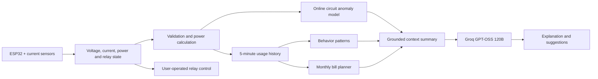

# VOLTRA AI/ML Technical Brief

**Code-reviewed:** 16 October 2026
**Purpose:** a concise technical reference for demos, reviews, viva questions, and investor conversations.

## The 20-second answer

VOLTRA uses a **hybrid intelligence architecture**:

1. An **online, unsupervised statistical anomaly model** learns normal active power, standby power, and runtime separately for every monitored circuit.
2. A **behavioral analytics engine** compares valid weekday or weekend history to find recurring start windows, unusual runtime, and schedule violations.
3. An **explainable rule-based bill planner** converts a monthly rupee target into a household energy allowance and per-load usage plan.
4. A **Groq-hosted `openai/gpt-oss-120b` generative LLM** explains the supplied household data and gives personalized suggestions.

VOLTRA currently does **not** use a neural network to classify appliances from one combined mains waveform. The connected loads are measured as separate ESP32/CT channels, then named by the user. This distinction matters: the current anomaly model is real ML in the broad sense of online adaptive statistical learning, but it is not deep learning, NILM, or a fault-diagnosis model.

## System architecture

The adaptive model and bill planner do not operate a relay. Relay changes come from an explicit user action. Installed electrical protection remains the safety authority.

## What intelligence is actually implemented

| Layer | Technique | Learns from data? | Output | Why it is used |
|---|---|---:|---|---|
| Telemetry | Electrical formulas and validation | No | W, VA, var, Wh and kWh | Converts raw readings into usable quantities |
| Circuit anomaly model | Online unsupervised mean/variance model with time decay | Yes | Sustained high-power and long-runtime observations | Learns each home without a labeled training set |
| Behavior model | Historical baselines plus deterministic rules | Partly | Start window, high runtime, out-of-schedule activity | Remains useful and explainable with small household datasets |
| Bill planner | Constraint-aware heuristic allocation | No | Rupee forecast and per-load energy/runtime targets | Produces transparent advice that can be audited |
| Usage assistant | Generative LLM through Groq | Pretrained externally; not trained by VOLTRA | Natural-language answers | Turns structured readings and settings into accessible guidance |
| Relay/protection logic | Deterministic control | No | On/off command and overload state | Control must be predictable and separate from probabilistic AI |

## 1. Telemetry and energy mathematics

### Power

When the device supplies direct branch power, VOLTRA uses that value. Otherwise it estimates real power as:

\[
P = V_{rms} I_{rms} PF
\]

where `P` is watts, `V` is volts, `I` is amperes, and `PF` is power factor.

Apparent and reactive power are:

\[
S = V_{rms} I_{rms}
\]

\[
Q = \sqrt{\max(0, S^2-P^2)}
\]

where `S` is volt-amperes and `Q` is reactive volt-amperes. If firmware does not provide a measured power factor, the current integration uses a nominal `0.98`; therefore those power values must be presented as estimates.

### Energy integration

Two valid readings are integrated only when their timestamps increase and the gap is at most 30 seconds. The average power over an interval is calculated by the trapezoidal rule:

\[
\bar P = \frac{P_{previous}+P_{next}}{2}
\]

\[
E_{Wh} = \frac{\bar P\Delta t}{3600}, \qquad E_{kWh}=\frac{E_{Wh}}{1000}
\]

Usage is stored in five-minute buckets. Disconnect gaps are left unknown rather than treated as zero usage. This avoids falsely lowering energy and runtime totals.

**Source:** [`usagePatterns.ts`](src/frontend/src/lib/usagePatterns.ts), [`esp32Api.ts`](src/frontend/src/services/esp32Api.ts), and [`voltricsStore.ts`](src/frontend/src/lib/voltricsStore.ts).

## 2. Adaptive anomaly model

### Model type

The model is an **online unsupervised adaptive anomaly detector**. “Online” means it updates as readings arrive. “Unsupervised” means it needs no pre-labelled normal/fault dataset. It maintains three distributions for every circuit:

- active-state power;
- standby-state power;
- completed active-session duration.

Active and standby are separated because a single average would mix two very different operating states. A circuit is active when its power is at or above its configured threshold, which defaults to 25 W.

### Online update

For observation \(x_t\), sample count \(n\), mean \(\mu\), and variance \(v\):

\[
n \leftarrow n+1
\]

\[
\alpha =
\begin{cases}
1/n, & n \leq 40\\
0.025, & n > 40
\end{cases}
\]

\[
\delta=x_t-\mu
\]

\[
\mu \leftarrow \mu+\alpha\delta
\]

\[
v \leftarrow \max\left(0,(1-\alpha)(v+\alpha\delta^2)\right)
\]

The first 40 samples create a cumulative baseline. After that, the fixed learning rate `0.025` gradually forgets older behavior, allowing the household baseline to follow seasonal or routine changes without letting one reading rewrite the model.

The effective standard deviation is deliberately floored:

\[
\sigma_{eff}=\max(\sqrt v, 0.05\mu, 10)
\]

This prevents an unrealistically stable circuit from producing alerts for tiny measurement noise. Power statistics learn at most once every five seconds, so a faster telemetry rate cannot make the model appear trained sooner.

### Cold start

| State | Requirement |
|---|---|
| Waiting | Fewer than 10 active plus standby samples |
| Learning | At least 10 samples, but the current state lacks its full baseline |
| Ready | At least 60 active samples or 90 standby samples |
| Runtime-ready | At least 5 valid completed sessions |

A completed session must last from 30 seconds to 24 hours. Any telemetry gap over 30 seconds breaks continuity. Reloading the app preserves learned distributions but deliberately discards an in-progress session.

### Sustained high-power detection

Once the corresponding active/standby baseline is ready:

\[
d=P_{current}-\mu
\]

\[
z=\frac{d}{\sigma_{eff}}
\]

\[
d_{min}=\max(50\text{ W},0.30\mu,4\sigma_{eff})
\]

A reading becomes a candidate only when \(d>d_{min}\). An event is created only after at least **three consecutive candidate readings spanning five seconds**. This persistence gate rejects brief switching spikes. A `z >= 7` event is marked important; other accepted events are notices. Three normal samples close the event. Candidate anomalies are excluded from learning so the model does not normalize the abnormal value while it is being assessed.

### Long-runtime detection

After five completed sessions, the limit is:

\[
T_{limit}=\mu_T+\max(3\sigma_T,900\text{ s},0.5\mu_T)
\]

An event is created when current session time exceeds \(T_{limit}\), and becomes important above \(1.5T_{limit}\). The rule needs both relative evidence and a meaningful absolute margin of at least 15 minutes.

### Why this model is appropriate now

- Every house and appliance behaves differently, so a per-home adaptive baseline is more useful than a generic global threshold.
- New users do not have labelled fault data; unsupervised learning works from ordinary operation.
- The method runs cheaply in the browser and remains understandable on an ESP32-scale product.
- Every observation can be explained using current value, learned mean, variation, sample count, and duration.
- It avoids claiming fault classification from a small, unlabelled dataset.

### Limitations

- An anomaly means “unusual compared with this circuit’s history,” not “electrical fault confirmed.”
- It cannot tell which appliance is active when several appliances share one monitored circuit.
- It currently learns in the browser, so history collection needs the VOLTRA application running and receiving valid telemetry.
- User feedback annotates an event but does not yet retrain the model.
- There is no fleet-wide model or cloud transfer learning.

**Source:** [`adaptiveAnomaly.ts`](src/frontend/src/lib/adaptiveAnomaly.ts) and [`ADAPTIVE_MODEL.md`](src/frontend/ADAPTIVE_MODEL.md).

## 3. Behavioral analysis

The behavioral layer uses recorded circuit activity rather than a neural sequence model.

1. A historical day is eligible only if it contains at least 12 hours of valid recorded coverage.
2. Today is compared with the same day type: weekday with weekdays, weekend with weekends.
3. A comparison baseline requires at least five earlier comparable days.
4. Mean daily active time is:

\[
\bar T_{active}=\frac{1}{N}\sum_{d=1}^{N}T_{active,d}
\]

5. “More active than usual” requires both:

\[
T_{today}>1.5\bar T_{active}
\]

and

\[
T_{today}-\bar T_{active}>3600\text{ s}
\]

6. A recurring start window appears after at least five observed starts whose earliest-to-latest spread is no more than two hours.
7. Scheduled activity is flagged after at least 15 minutes outside the user’s allowed window.

This design avoids pretending that one or two days form a stable habit. The user’s schedule and runtime target are explicit rules, while recurring windows and runtime comparisons are learned observations.

**Source:** [`usagePatterns.ts`](src/frontend/src/lib/usagePatterns.ts) and [`USAGE_PATTERNS.md`](src/frontend/USAGE_PATTERNS.md).

## 4. Monthly bill planning

This is an explainable **heuristic planning engine**, not a trained regression model and not reinforcement learning.

### Manual appliance estimate

For an unmonitored appliance:

\[
E_{daily}=\frac{W\times quantity\times hours/use\times uses/week}{1000\times7}
\]

### Monitored load estimate

VOLTRA prefers up to 14 complete days. A complete day needs at least 12 hours of coverage. Each partial recorded day is normalized to 24 hours:

\[
E_{normalized,d}=E_{recorded,d}\frac{86400}{secondsRecorded_d}
\]

The daily estimate is the average of the selected normalized days. It is marked **measured** after at least five complete days; otherwise it remains **learning**. Normalization is a practical estimate and can be biased if the unrecorded hours differ from the recorded hours.

### Converting a rupee target into energy

Let target bill be \(B\), tax percentage \(t\), fixed charges \(F\), effective tariff \(r\) in ₹/kWh, and billing days \(D\):

\[
m=1+\frac{t}{100}
\]

\[
E_{budget}=\max\left(0,\frac{B/m-F}{r}\right)
\]

\[
E_{allowance/day}=\frac{E_{budget}}{D}
\]

For the current household estimate \(E_{current/day}\):

\[
R_{required/day}=\max(0,E_{current/day}-E_{allowance/day})
\]

### Preserving essential usage

Each category has a minimum retained fraction: essential/refrigerator 95%, AC 55%, washing machine 68%, water heater 60%, lighting/pump 75%, fan 80%, cooking/other 82%, and mixed circuits 88%.

For load \(i\) with daily energy \(E_i\) and retained fraction \(f_i\):

\[
R_{available}=\sum_i E_i(1-f_i)
\]

\[
s=\begin{cases}
\min(1,R_{required}/R_{available}), & R_{available}>0\\
0, & R_{available}=0
\end{cases}
\]

\[
R_i=E_i(1-f_i)s
\]

\[
E_{recommended,i}=E_i-R_i
\]

Runtime is scaled proportionally:

\[
T_{recommended,i}=T_i\frac{E_{recommended,i}}{E_i}
\]

Finally:

\[
Bill_{planned}=(D\sum_iE_{recommended,i}\times r+F)m
\]

These retained fractions are transparent product heuristics, not learned coefficients. The current tariff is a flat effective rate, so the result is advisory when the utility uses slabs, time-of-day rates, demand charges, subsidies, or changing fuel adjustments.

**Source:** [`billPlan.ts`](src/frontend/src/lib/billPlan.ts).

## 5. Groq generative AI assistant

VOLTRA’s language layer uses Groq’s hosted Chat Completions API. The default model configured in the backend is **`openai/gpt-oss-120b`**: a 120-billion-parameter Mixture-of-Experts model with about 5.1 billion active parameters per forward pass, a 131,072-token context window, and text reasoning/tool-use capabilities according to [Groq’s current model card](https://console.groq.com/docs/model/openai/gpt-oss-120b).

VOLTRA does not fine-tune or train this model. It performs **context grounding**:

- the frontend constructs a structured summary of current source, circuit statistics, patterns, bill target, declared appliances, user labels, and relevant household settings;
- the backend places that JSON after a restrictive system prompt;
- the assistant is told to distinguish measured, demo, estimated, and missing data and to avoid inventing appliance identities, savings, faults, or completed actions;
- at most eight recent turns are included;
- generation uses temperature `0.25` and a maximum of 1,000 completion tokens.

This is not vector-database RAG: there are no embeddings, semantic retrieval, or vector store in the current implementation. It is prompt-based grounding with current application context.

The backend also limits input sizes, applies per-IP and process-wide rate limits, bounds concurrent calls, and uses explicit network timeouts. The LLM has no relay-control tool, sensor connection, or autonomous action path.

**Why Groq:** the hosted model provides strong natural-language reasoning without putting a large model on the ESP32 or phone, and Groq lists the selected model as a production model with high-throughput inference. The design keeps numerical calculations in deterministic code; the LLM explains their results rather than being trusted to calculate or control them.

**Source:** [`usage_router.py`](src/backend/usage_router.py) and [`usageAssistant.ts`](src/frontend/src/services/usageAssistant.ts).

## 6. What is AI, and what is conventional software?

Use these exact descriptions when questioned:

- **“Is VOLTRA AI?”** Yes. It combines adaptive statistical learning with a pretrained generative LLM. Most energy and safety calculations remain deterministic by design.
- **“Which ML algorithm?”** A per-circuit online unsupervised anomaly detector using adaptive mean and variance, effective z-scores, persistence gates, and runtime distributions.
- **“Which deep-learning model?”** The product does not run a custom deep model on telemetry. Its conversational layer uses Groq-hosted GPT-OSS 120B.
- **“Is this NILM?”** No. Current circuit measurements are separate sensor channels. VOLTRA does not yet disaggregate many appliances from one aggregate mains waveform.
- **“Does AI trip breakers?”** No. The adaptive model and LLM are advisory. Relay commands require a direct user action; deterministic overload behavior is separate.
- **“Does it diagnose appliance faults?”** No. It detects statistical deviations and recommends review.
- **“Does it predict an exact bill?”** No. It estimates a bill from recorded/declared usage and the user’s effective tariff settings.

## 7. Indian competitors and adjacent products

Success figures below are company-reported unless stated otherwise. They demonstrate commercial traction or observed outcomes, not an independent head-to-head benchmark against VOLTRA.

| Brand | What it does | Public success evidence | How VOLTRA differs today |
|---|---|---|---|
| **SustLabs / Ohm Assistant** | Reads high-frequency main-panel waveforms and uses ML for appliance-level visibility without a sensor on every appliance; also offers safety and smart-distribution-board functions. | SustLabs reports **12,000+ deployments, 17.5% electricity savings observed, and four avoided fires**. Its older product documentation reports about **85% average detection accuracy** with stated limitations. [Official site](https://sustlabs.com/) · [Product documentation](https://sustlabs.zohodesk.in/portal/en/kb/articles/d001) | Technically the closest Indian comparison. SustLabs is ahead in NILM and aggregate appliance identification. VOLTRA instead uses direct circuit sensing, exposes its thresholds/formulas, adds a rupee-target load plan, user relay control, and a Groq-grounded assistant. |
| **Tata Power EZ Home** | Smart switches/controllers, scheduling, remote appliance control, built-in metering, overload features, and consumption tracking. | Tata Power markets **up to 20% bill savings** and continues expanding the product through retail and regional channels. Its FY 2025–26 report says EZ Home progressed on AI-based load prediction and won a Ministry of Power AI/ML home-automation recognition. [Product page](https://www.tatapower.com/ezhome/) · [FY 2025–26 report](https://www.tatapower.com/company-financials/annual-reports/107annualreport-2025-26.pdf) | Tata has much stronger brand, distribution, installation, and product maturity. VOLTRA’s differentiation is a visible per-circuit learning model, detailed behavior evidence, target-to-appliance budgeting, and an assistant grounded in the same household context. |
| **Zenatix by Schneider Electric** | IoT monitoring, cloud/edge analytics, predictive maintenance, HVAC/lighting control, and multi-site optimization, mainly for commercial buildings. | Zenatix reports **50+ enterprises, 3,000+ sites, up to 20% energy-cost reduction, and typical ROI under two years**. A retail case study reports 13% efficiency improvement and 19% fewer asset breakdowns. [Official site](https://www.zenatix.com/) · [Retail case study](https://www.zenatix.com/case-study/zenatix-at-retail) | Zenatix is a mature B2B building platform, not a direct household app. VOLTRA targets a smaller residential/SME installation with low-cost ESP32 hardware, household behavior views, individual relay control, and a consumer bill target workflow. |
| **Bidgely** *(India-founded, global utility platform)* | Cloud-scale NILM and utility analytics that disaggregate whole-home meter data into appliance categories and power customer-service, program-targeting, and GenAI workflows. | Bidgely reports **30+ utilities and 24M+ active homes**; its disaggregation has trained across tens of thousands of homes and operates in 15+ countries. It reports utility program results such as 565,000 therms saved by SoCalGas. [Platform](https://site.bidgely.com/) · [Disaggregation](https://www.bidgely.com/disaggregation) | Bidgely is far ahead in fleet scale, utility integration, and NILM. VOLTRA is an edge/home prototype with direct branch sensors and physical relay control, transparent local statistics, and no need for a utility smart-meter data agreement. |

## 8. International competitors

| Brand | What it does | Public success evidence | How VOLTRA differs today |
|---|---|---|---|
| **Sense** (US) | Samples mains waveforms at up to 1 MHz and uses ML/device signatures for appliance identification and grid-edge insights. It is moving its consumer experience into compatible smart meters. | Sense reports **700M+ hours of data across 4M devices and 1M user labels**, and said its software was reaching more than **3.5M homes** in 2025. Earlier research used 14,948 monitored households. [Technology](https://sense.com/utilities/technology/) · [Scale statement](https://sense.com/event/exchange-2025/) | Sense is far ahead in high-frequency NILM, training data, and utility deployment. VOLTRA offers explicit circuit-level sensing and relay control, simpler explainable local anomaly logic, and a target-based monthly action plan. |
| **SPAN** (US) | A replacement smart electrical panel with 16–48 controllable circuits, circuit-level monitoring, remote control, battery backup prioritization, EV optimization, and learned cost-saving insights. | SPAN is a commercial, electrician-installed product starting around **US$2,550 before installation** and is available in the US and Puerto Rico. Its public materials describe a goal of 10M electrified homes by 2030, rather than a current installed-base figure. [Panel](https://www.span.io/panel) · [Availability and pricing](https://support.span.io/hc/en-us/articles/4410667562903-How-can-I-get-SPAN) | SPAN is a certified, premium panel ecosystem with broader circuit coverage and energy-resource orchestration. VOLTRA is a lower-cost retrofit prototype with fewer channels, more visible formulas, and India-oriented rupee budgeting. SPAN’s goal is not evidence that 10M homes are already installed. |
| **Emporia Vue** (US) | Panel-mounted main and branch CT monitoring with up to 16 individual circuit sensors, real-time app graphs, tariff-aware analysis, and optional load management. | Emporia sells a mature retail hardware line, but the reviewed official product material does not publish a verified installed-base or average savings figure. [Official Vue 3 product sheet](https://cdn.emporiaenergy.com/products/vue3/vue3-energy-monitor-sell-sheet.pdf) | Its sensing architecture is close to VOLTRA’s circuit-CT approach and it supports more production-ready channels. VOLTRA adds per-circuit adaptive anomaly baselines, behavior-stage explanations, a rupee-target allocation engine, and a personalized Groq assistant. |

## 9. Defensible differentiation

VOLTRA’s credible differentiation is the combination of:

1. **Direct circuit evidence:** each installed CT channel gives an observable branch load instead of guessing appliance identity from total mains power.
2. **Per-home cold start and adaptation:** the model starts with explicit learning states and gradually adapts to that household.
3. **Explainability:** the user can trace alerts to mean, variation, sample count, sustained duration, and runtime history.
4. **Behavior plus budget:** it connects what happened, what is unusual, and what daily load allocation could meet a rupee target.
5. **Measured plus declared household:** monitored circuits form the base; appliances outside those circuits enter the plan only when the user adds them.
6. **Context-grounded conversation:** Groq receives the same source labels, coverage, settings, load names, patterns, and bill target visible to the product.
7. **Separated authority:** statistical observations, language suggestions, and relay control have distinct paths.

The strongest honest pitch is **“an explainable, adaptive circuit-level home energy copilot with budget planning and user-governed control.”** Avoid claiming that VOLTRA already outperforms fleet-scale NILM systems, predicts appliance failures, or guarantees bill savings.

## 10. Best next ML upgrades

| Priority | Upgrade | Data required | Benefit |
|---:|---|---|---|
| 1 | Calibrated power factor and voltage/current sensor calibration | Reference meter readings | Improves every downstream energy and bill result |
| 2 | Persist telemetry/model on the backend | Authenticated time-series storage | Learning continues when the page is closed and works across devices |
| 3 | Back-tested threshold evaluation | Logged events plus user-confirmed expected/review labels | Measures precision, recall, false-alert rate, and detection delay |
| 4 | Time-of-day conditional baselines | Several weeks per circuit | Separates normal daytime and nighttime behavior |
| 5 | Probabilistic bill forecast | More complete days, tariff slabs, weather/season | Gives a range such as P50/P90 rather than one point estimate |
| 6 | Appliance classification/NILM | High-frequency aggregate waveform plus labelled switch events | Identifies appliances that share one mains channel |
| 7 | Constrained optimizer | Comfort windows, tariff slabs, essentiality and controllability | Replaces category fractions with a formally optimized schedule |

Before adding a deep model, collect a clean dataset with timestamps, raw waveform or calibrated electrical features, circuit/appliance labels, relay transitions, missing-data markers, user feedback, and ground-truth meter energy. Model complexity without reliable ground truth would make the product less defensible.

## Rapid-fire answers

**Why not use a neural network now?**
The current installation has little labelled household data and only a few direct load channels. The online statistical model learns faster, costs less, and makes every alert explainable.

**How does the system handle a new user?**
It shows Waiting/Learning states, calculates direct telemetry immediately, uses user rules immediately, and unlocks comparisons only after enough valid samples or comparable days. The LLM is instructed to say when evidence is insufficient.

**Can one unusual spike corrupt the model?**
Candidate high-power anomalies are withheld from baseline updates, and an alert needs three readings over at least five seconds.

**Why use a z-score plus an absolute threshold?**
The z-score adapts to each circuit’s variability. The 50 W, 30%, and four-sigma floor prevents harmless numeric noise from becoming an alert.

**Why separate weekdays and weekends?**
Household routines differ substantially, so mixing them would create misleading runtime and start-time baselines.

**Why use the LLM if formulas already produce the result?**
The deterministic engine provides the evidence. The LLM translates it into a personalized explanation and practical next actions without controlling the system.

**How is personalization done?**
Through current circuit evidence, user labels, usage goals, schedules, runtime thresholds, bill target, tariff settings, declared appliances, and limited household profile fields. It is context injection, not model retraining.

**Can we quote competitor savings as guaranteed?**
No. They are vendor-reported outcomes or marketing claims under particular deployments. VOLTRA also must validate savings through controlled pilots before publishing a percentage.
